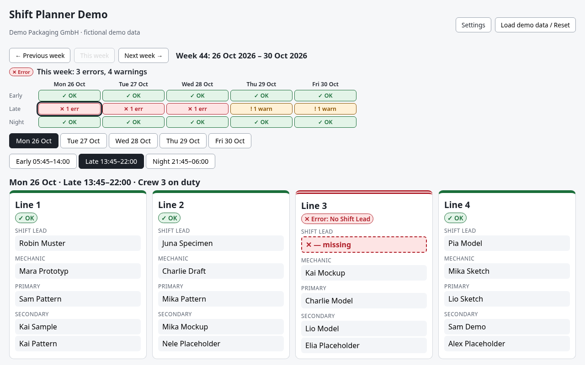

# Shift Planner Demo

A small shift-planning tool for a fictional three-shift production plant,
**Demo Packaging GmbH**, with four packaging lines (Line 1 - Line 4).

> **Fictional data.** Every company, line, crew and person in this project is made up.
> Names are generated from invented placeholder lists; any resemblance to real people or
> organisations is coincidental.
>
> **Built with AI-assisted development.** The code was written with the help of an AI
> coding assistant and reviewed, tested and directed by me.



## Deutsch

Die Oberfläche der App ist auf Deutsch. Ein kleiner Schichtplaner für ein fiktives
Dreischicht-Werk (**Demo Packaging GmbH**) mit vier Verpackungslinien (Linie 1 bis Linie 4)
und den Schichten Früh, Spät und Nacht.

- **Wochenleiste:** 15 Felder (Mo-Fr x Früh/Spät/Nacht) zeigen den Status jeder Schicht
  mit Symbol und Text (✓ OK, ! Warn., ✕ Fehl.). Ein Klick öffnet die Schicht.
- **Linienkarten:** feste Zeilen für Linienleiter, Mechaniker, Primär und Sekundär (1-2).
  Leere Plätze zeigen **„— fehlt“** und gelten als Fehler.
- **STL-Badge:** zeigt den STL im Dienst oder die Warnung „Kein STL im Dienst“.
- **Vertretung:** Ein Klick auf einen Platz öffnet Vertretungsvorschläge. Die App schlägt nur
  vor; die Planerin bzw. der Planer entscheidet mit _Übernehmen_.
- **Einstellungen → Liniennamen:** nur im `localStorage` dieses Browsers gespeichert.
- Alle Personen und die Firma sind fiktiv. Übernommene Vertretungen liegen nur im Speicher.

## Why

Planning shifts in manufacturing is often done in spreadsheets: who is on which line,
who is on vacation, and who can cover when someone calls in sick. This project models
those rules as typed, tested, pure functions so a planner can see staffing gaps at a
glance and get **suggestions** for cover. The planner always makes the final decision.

## Status

- **Step 1:** domain model, rules, demo data, tests.
- **Step 2:** line-first planner: one shift at a time with Line 1-4 cards, a week status
  strip, and a cover panel with ranked suggestions the planner can accept. Accepted covers
  live in memory only; custom line names live in `localStorage`.
- Next: browser `localStorage` persistence, deployment.

## Using the planner

- **Week strip:** 15 small chips (Mon-Fri x Early/Late/Night) show each shift's status with an
  icon and text (✓ OK, ! warn, ✕ err). Click a chip to open that shift. A one-line summary
  shows the week's total errors and warnings.
- **One shift at a time:** day tabs and shift tabs, with the shift times, the crew on duty and its STL.
- **Line cards (Line 1-4):** each card has fixed rows: Line Leader, Mechanic, Primary,
  Secondary (1-2). Empty slots read **"— missing"** and are styled as errors. The card header
  says what is wrong in a few words (e.g. "No Primary", "Only 1 Secondary").
- **Shift tints:** the selected shift's area, its tab and its week-strip label get a light
  tint (Early green, Late yellow, Night rose) plus an icon (☀️ / 🌇 / 🌙). Tints are decorative;
  line cards stay white so the status inside them stays clear.
- **STL badge:** the STL on duty is shown in a bold badge next to the shift heading, or a
  warning badge "No STL on duty" with the absent name.
- Status always uses colour **and** an icon **and** text, so it does not rely on colour alone.
- **Cover:** click a slot to open the cover panel with that role preselected.
  **The app only suggests; the planner decides** by pressing _Accept_. Each crew has two
  spare people, so same-crew cover is usually available.
- **Settings → Line names:** rename lines for your own use. Names are stored only in this
  browser's `localStorage` and are never part of the repository.
- **Load demo data / Reset** restores the seeded demo data and discards accepted covers.
- On a weekend, "This week" means the coming week.

### Absences (Abwesenheiten)

Below the shift view, the planner can add an absence (person, type, from/to inclusive) and remove
existing ones. The week view updates immediately: affected slots show as `fehlt`, the rule check
reports warnings/errors and the side panel offers cover suggestions. Input is validated with zod
(`to >= from`, person exists, no overlapping absence for the same person). Absences are stored in
this browser's localStorage under the versioned key `shift-planner-demo.absences.v1`; unreadable
or outdated data falls back to the generated demo data. **Demo zurücksetzen** clears them.

## Domain rules

**Shifts** (Monday-Friday only, no Sunday or holiday work; a shift belongs to the date it starts):

| Shift | Time          |
| ----- | ------------- |
| Early | 05:45 - 14:00 |
| Late  | 13:45 - 22:00 |
| Night | 21:45 - 06:00 |

**Roles:** Primary, Secondary, Line Leader, Mechanic (staffed per line), plus one
**STL (Shift Team Leader)** per crew who leads the whole shift.

- The STL on duty is shown in the shift heading. The STL is not counted in line staffing and
  is never suggested as line cover. If the STL is absent, the shift gets a **warning**
  "No STL on duty" (not an error).

**Minimum staffing per line and shift**

| Role        | Rule                                                                        |
| ----------- | --------------------------------------------------------------------------- |
| Primary     | exactly 1 (none = error, more than 1 = warning)                             |
| Secondary   | at least 1 (none = error), 2 is optimal (1 = warning)                       |
| Line Leader | 1 (none = error)                                                            |
| Mechanic    | ideally 1 per line; per shift: fewer than 2 = error, fewer than 4 = warning |

**Qualifications:** each person is qualified for certain roles on certain lines.

- Mechanics can work as mechanic on any line, and can stand in as operator only on their listed lines.
- A Line Leader can stand in as Secondary; as Primary only as a last resort (warning).
- Absent or unqualified people do not count toward the minimums.

**Absences:** Vacation, Sick, Training, Overtime off, Contract end.

**Crews and rotation:** three crews rotate weekly in a backward rotation
(Early -> Night -> Late). The app shows an informational note that forward rotation
(Early -> Late -> Night) is generally recommended, but does not enforce it.

**Cover suggestions** are ranked:

1. Qualified for the role, from the crew on that shift and not yet assigned
2. Qualified for the role, from another crew (with a rest-time note)
3. Stand-ins (Line Leader as Secondary, Mechanic as operator)
4. Stand-ins with a warning (Line Leader as Primary)

## Tech

- Vite + React + TypeScript (`strict`, `noUncheckedIndexedAccess`)
- zod for schemas and runtime validation
- Vitest + Testing Library for unit and component tests
- ESLint (flat config) + Prettier
- Deterministic, seeded demo-data generator (69 people in 3 crews: 20 line staff, 2 spares and 1 STL each)

```
src/domain/
  schemas.ts         zod schemas + types (Person, Crew, Line, Shift, Absence, Assignment, Plan)
  constants.ts       lines, crews, shift times, staffing targets
  rotation.ts        which crew works which shift in a given week
  qualifications.ts  who may fill which role on which line (incl. stand-ins)
  availability.ts    absences, weekends/holidays, double bookings
  staffing.ts        per-line and per-shift checks -> errors / warnings / info
  cover.ts           ranked cover suggestions
  demoData.ts        seeded fictional data
```

## Getting started

```bash
npm install
npm run dev        # placeholder UI
npm test           # unit tests
npm run lint
npm run typecheck
```

## License

MIT
